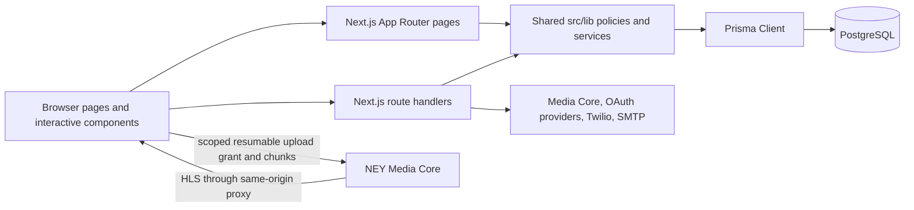

# NEY ANIMATE developer guide

This guide is the code-oriented map for engineers who need to operate or extend the current application. It describes the implementation in this repository; it is not a production-readiness certification. Read it with the specialized guides for [authentication](authentication.md), [platform analytics](platform-analytics.md), [database backup and restore](database-backup-and-restore.md), [kids content editorial review](kids-content-editorial-checklist.md), the [engineering overview](engineering-overview.md), and the [2026-10-24 test report](test-report-2026-10-24.md).

## 1. Product and runtime at a glance

NEY ANIMATE is a single Next.js App Router application. TypeScript and React render the public catalogue, account flows, and admin studio. Route handlers expose JSON APIs and call shared server-side modules. Prisma maps PostgreSQL records to application types. NEY Media Core handles video uploads, processing, and playback. Google, Apple, Discord, Twilio Verify, and SMTP are optional identity and email integrations.

The main execution path is:



Pages that need account-specific or database-backed data are rendered dynamically. Server Components load initial page data and enforce page access; Client Components handle forms, filters, polling, player events, and upload progress. API Route Handlers validate and authorize each request independently. Do not assume that hiding a button protects an endpoint.

## 2. Repository layout

| Location | What belongs here | When it runs / how it is used |
| --- | --- | --- |
| `src/app/` | URL pages, nested layouts, metadata, and API Route Handlers | Next.js maps `page.tsx` to pages and `route.ts` to HTTP endpoints. |
| `src/components/` | Site-wide UI shared by multiple routes | Imported by the root layout or account pages. |
| `src/lib/` | Database, authorization, data access, validation, provider integration, and policy helpers | Imported by server pages, Route Handlers, and tests. Keep browser-only code out of server-only helpers. |
| `prisma/schema.prisma` | PostgreSQL models, enums, and relations | Source for Prisma Client and future migrations. |
| `prisma/migrations/` | Ordered, reviewed SQL schema changes | Apply to each environment through its deployment migration process. |
| `prisma/seed.ts` | Clearly fictional demo catalogue entries | Run only against an intentional development database. It does not create an administrator. |
| `scripts/bootstrap-admin.ts` | Guarded, one-time first administrator bootstrap | Invoked with `npm.cmd run auth:bootstrap-admin` after its environment values and database are set. |
| `tests/` | Node test-runner tests for policies, APIs, integrations, and schema behavior | Run with `npm.cmd test`; DB-backed cases require a reachable development database. |
| `docs/` | Maintainer, operations, identity, analytics, editorial, and test documentation | Read before changing the corresponding subsystem. |
| `public/` | Files served as static assets | Local ambient clips live under `public/videos/`; they are not catalogue video uploads. |
| `next.config.ts` | Turbopack root/CSS loader and response security headers | Evaluated by Next.js at server startup/build. Review for new providers or script origins. |
| `tsconfig.json` | Strict TypeScript, bundler module resolution, Next plugin, and `@/*` → `src/*` import alias | Type checking and editor/build resolution. |
| `eslint.config.mjs` | ESLint 9 / Next rules | `npm.cmd run lint`. |
| `.env.example` | Names and placeholder values for supported environment settings | Copy to `.env` locally; do not put real secrets here. |
| `package.json` | Dependencies and developer scripts | npm is the package manager; use `npm.cmd` in Windows PowerShell when needed. |

## 3. Page and interactive component inventory

### Site shell and public pages

| File | Component / route | Purpose and behavior |
| --- | --- | --- |
| `src/app/layout.tsx` | `RootLayout` | Wraps every page in the shared background and header, imports global CSS, and sets the base document metadata. |
| `src/app/globals.css` | Global styles | Tailwind v4 entry point plus site-level background, glass panels, motion, and layout styles. Change this when a visual rule should apply across routes. |
| `src/components/site-header.tsx` | `SiteHeader` | Shared navigation and identity. Reads the current account on the server to show appropriate staff/account navigation. |
| `src/components/ambient-background.tsx` | `AmbientBackground` | Decorative, muted site-wide looping video/background layer. Uses local `public/videos` clips and must respect reduced-motion behavior. It is not a catalogue film player. |
| `src/app/page.tsx` | `/` | Loads published catalogue entries, selects the hero and featured/latest cards, and renders the homepage. If PostgreSQL is configured, the published catalogue query needs the database. |
| `src/components/skyline-introduction.tsx` | `SkylineIntroduction` | Homepage hero visual/introduction. Its local footage is sample/ambient material, not proof of a published feature asset. |
| `src/app/films/page.tsx` | `/films` | Server-rendered browse page. Reads query-string filters and displays published catalogue cards; filter choices are reflected in URL state. |
| `src/app/films/[slug]/page.tsx` | `/films/:slug` | Loads one published film by slug, builds route metadata, and renders its details and playback panel. Unpublished titles must not be exposed here. |
| `src/app/films/[slug]/playback-panel.tsx` | `PlaybackPanel` | Client-side HLS.js player using the same-origin Media Core playback proxy; sends playback events for analytics. |
| `src/app/icon.png`, `src/app/favicon.ico` | App icon files | Next.js metadata icon and browser favicon. Verify the rendered browser icon when replacing branding. |
| `src/app/favicon.icon.png` | Additional icon image | Non-standard filename; it is not referenced by application code. Confirm whether any external tooling uses it before removing it. |

### Static public assets

| File | Purpose |
| --- | --- |
| `public/videos/ambient-1.mp4` | Site-wide ambient backdrop fallback used by `AmbientBackground`. |
| `public/videos/ambient-2.mp4` | Preferred homepage intro clip used by `SkylineIntroduction`; replace the placeholder only with authorized footage. |
| `public/videos/README.txt` | Notes for the local ambient-video directory. |
| `public/count with milo.mp4` | Local sample media file. It is not a provider `VideoAsset` and does not make the fictional catalogue title publishable. |
| `public/ambient-2.mp4` | Unreferenced root-level media asset. The ambient components use `/videos/ambient-*.mp4` instead. |
| `public/file.svg`, `public/globe.svg`, `public/window.svg`, `public/next.svg`, `public/vercel.svg` | Starter/demo SVG assets. They are static files and are not required by the application route/data model. |

### Account pages and forms

| File | Component / route | Purpose and behavior |
| --- | --- | --- |
| `src/app/login/page.tsx` | `/login` | Sign-in page shell and metadata. |
| `src/app/login/login-form.tsx` | `LoginForm` | Client email/password form; calls the login API and handles validation, errors, and navigation. |
| `src/app/auth-options.tsx` | `AuthOptions` | Shows optional provider sign-in buttons only when the corresponding provider is configured. |
| `src/components/phone-sign-in-form.tsx` | `PhoneSignInForm` | Two-step phone sign-in: request a Twilio Verify code, then submit the code for verification and account/session creation. Phone input uses E.164 format. |
| `src/app/register/page.tsx` | `/register` | Registration page shell and metadata. |
| `src/app/register/register-form.tsx` | `RegisterForm` | Client email/password sign-up form. New self-service accounts always receive `VIEWER`, never staff roles. |
| `src/app/forgot-password/page.tsx` | `/forgot-password` | Password-recovery page shell. |
| `src/app/forgot-password/forgot-password-form.tsx` | `ForgotPasswordForm` | Requests a reset email. The server response avoids revealing whether an address exists. Delivery requires SMTP configuration. |
| `src/app/reset-password/page.tsx` | `/reset-password` | Password reset page shell. |
| `src/app/reset-password/reset-password-form.tsx` | `ResetPasswordForm` | Submits a one-time recovery token and new password, then reports the result. |
| `src/components/sign-out-button.tsx` | `SignOutButton` | Calls the logout endpoint and clears the server session cookie. |

### Admin studio and analytics UI

| File | Component / route | Purpose and behavior |
| --- | --- | --- |
| `src/app/studio/page.tsx` | `/studio` | Dynamic, admin-only studio page. Resolves the session, redirects non-admins, loads film counts and the latest 100 film records with recent video assets, then renders draft creation and the library. |
| `src/app/studio/studio-forms.tsx` | `FilmDraftForm`, `LogoutButton` | Draft creation/editing controls and logout UI. Slug generation follows title entry; form choices constrain years, durations, access, genres, and minimum age before the server validates them again. |
| `src/app/studio/studio-library.tsx` | `StudioLibrary`, `FilmCard` | Lists drafts and published records, refreshes from the studio API, selects feature/trailer files, requests an asset-scoped Media Core grant, transfers resumable 50 MiB chunks directly to Core, polls processing, and offers publish only when the feature is ready. |
| `src/app/studio/analytics/page.tsx` | `/studio/analytics` | Dynamic admin-only route. Checks active admin session, calculates the initial metrics server-side, and renders the dashboard. |
| `src/app/studio/analytics/analytics-dashboard.tsx` | `AnalyticsDashboard`, chart helpers | Interactive CRM dashboard; displays account/view/watch trends, retention, film performance, and recent viewer activity. Polls the analytics API every 15 seconds. |

## 4. HTTP API inventory

All API files are Next.js Route Handlers under `src/app/api`. The handlers use Web `Request`/`Response` objects and `NextResponse`. A route's HTTP method is its exported function name. Mutation handlers should validate input and enforce same-origin and server-side authorization before changing data.

### Public catalogue, playback, and readiness

| Endpoint | Method(s) | Behavior |
| --- | --- | --- |
| `/api/films` | `GET` | Validates catalogue filters and pagination, then returns published films only. Uses database catalogue when configured and fictional fallback data for read-only preview when it is not. |
| `/api/films/[slug]` | `GET` | Returns a published film by slug; drafts/archived/missing films return not found. |
| `/api/films/[slug]/playback` | `GET`, `POST` | Applies playback eligibility and player/session operations for a film. The server, not the client, decides publication/access policy. Read this handler alongside `src/lib/access.ts` and `src/lib/playback.ts` before changing access rules. |
| `/api/analytics/playback-session` | `POST` | Receives same-origin playback session creation/heartbeat/end events; validates the capability token and event data and stores bounded watch-time data. |
| `/api/health` | `GET` | Lightweight liveness endpoint. A 200 means the app process answered; it does not prove database readiness. |
| `/api/ready` | `GET` | Readiness check for configured dependencies such as PostgreSQL and rate-limit storage. Use this for dependency health. |

### Authentication and account recovery

| Endpoint | Method(s) | Behavior |
| --- | --- | --- |
| `/api/auth/register` | `POST` | Validates email/name/password/confirmation, throttles by IP and email, hashes the password, creates a viewer and audit record transactionally, then creates a session. |
| `/api/auth/login` | `POST` | Throttles by IP and normalized email, verifies bcrypt password and active state, creates a session and audit record. |
| `/api/auth/logout` | `POST` | Deletes the current persisted session and clears the session cookie. |
| `/api/auth/me` | `GET` | Returns the current active account summary from the server session or an unauthenticated result. |
| `/api/auth/forgot-password` | `POST` | Throttles reset requests, creates a short-lived one-use token hash, and asks SMTP to deliver a reset link without exposing account existence. |
| `/api/auth/reset-password` | `POST` | Validates an unused, unexpired token, updates the password hash, invalidates prior sessions, and audits the reset. |
| `/api/auth/oauth/[provider]` | `GET` | Starts Google, Apple, or Discord authorization with provider-specific state/PKCE/nonce handling and short-lived flow cookies. |
| `/api/auth/oauth/[provider]/callback` | `GET`, `POST` | Exchanges provider callbacks, validates state and provider identity/claims, links or creates viewer identities, then establishes the normal app session. Apple can use POST form callback. |
| `/api/auth/phone/start` | `POST` | Validates E.164 phone input, applies IP/number limits, and starts Twilio Verify delivery. |
| `/api/auth/phone/verify` | `POST` | Verifies the SMS code with Twilio, creates/fetches a viewer by verified phone, audits, and creates a session. |

### Studio, upload, and provider callbacks

| Endpoint | Method(s) | Behavior |
| --- | --- | --- |
| `/api/studio/films` | `GET`, `POST` | Admin-only film list and draft creation. Creation validates metadata and writes the film/audit event. |
| `/api/studio/films/[id]` | `PATCH` | Admin-only draft metadata update. It rejects demo films and non-editable publication states and reports slug conflicts. |
| `/api/studio/films/[id]/publish` | `POST` | Admin-only publishing transition. Verifies the Media Core feature asset is ready and published before setting a non-demo film as published. |
| `/api/studio/videos/direct-upload` | `POST` | Admin-only Media Core asset and short-lived grant creation. The service key stays on the server; the browser receives only the grant. |
| `/api/studio/videos/[id]/upload-grant` | `POST` | Admin-only grant renewal for the same unfinished file, allowing transfer to resume after a short-lived token expires. |
| `/api/studio/videos/[id]/status` | `GET` | Admin-only status refresh from Media Core; updates the local processing state. |
| `/api/studio/analytics` | `GET` | Admin-only analytics snapshot API. Accepts a bounded date range and returns aggregated metrics without caching. |

## 5. Shared server modules (`src/lib`)

| Module | Responsibility | Used when |
| --- | --- | --- |
| `db.ts` | Creates a shared Prisma Client; `isDatabaseConfigured()` detects missing/template connection strings. | Any request or page reads/writes PostgreSQL. |
| `auth.ts` | Opaque session generation, SHA-256 token hashing, cookie management, session lookup/deletion, role predicates, and same-origin enforcement. | Login, session checks, and protected state-changing requests. |
| `access.ts` | Pure publication/access policy for free and premium films. Premium access requires a trusted entitlement input. | Playback APIs and access-policy tests. |
| `catalogue.ts` | Maps Prisma film records to the UI `Film` shape; filters published rows; uses static demo records only if DB is not configured. | Home, browse, and public film detail routes. |
| `films.ts` | Typed, fictional sample catalogue and lookup helpers. Demo film rows are not real inventory and have no playable provider asset. | Offline/read-only preview and demo tests. |
| `educational-content.ts` | Validates and formats optional minimum-age recommendations. | Studio forms, catalogue display, and tests. This is editorial metadata, not official age classification. |
| `oauth-auth.ts` | Provider configurations, OAuth authorization URL/state/PKCE helpers, Apple client-secret signing, provider profile verification, and account linking. | OAuth start/callback and provider availability UI. |
| `phone-auth.ts` | Twilio Verify HTTP integration for sending and checking one-time codes. | Phone start/verify endpoints. |
| `email.ts` | SMTP configuration check and password recovery email delivery through Nodemailer. | Forgot-password endpoint. |
| `rate-limit.ts` | Client IP extraction and rate-limit logic: Redis first, PostgreSQL fallback, memory fallback for non-production; production fails closed when shared storage fails. | Login, registration, OAuth/phone/recovery, and other throttled routes. Trust proxy headers only when configured. |
| `media-core.ts` | Server-only Media Core client for assets, scoped grants, status, publishing, playback authorization, and HLS proxy requests. | Studio upload/status/publish routes and public playback routes. |
| `playback.ts` | Validates Media Core asset IDs and constructs same-origin playlist URLs. | Public player route; avoids arbitrary player hosts. |
| `tus-upload.ts` | Core upload ceiling, chunk size, stable browser resume fingerprint, and TUS offset validation. | Resumable upload client and tests. |
| `analytics.ts` | SQL-backed admin aggregates, daily trend series, retention cohorts, popular titles, and recent-viewer summary. | Admin dashboard render/API only. Treat returned account details as private. |
| `analytics-events.ts` | Pure watch-time credit and completion calculations. Caps credited intervals and excludes seeks/paused time. | Playback event handler and unit tests. |
| `env.ts` | Zod environment schema and production configuration checks. | Server startup/deployment validation paths; add settings here when adding required config. |

## 6. Core data model and persistence

Prisma schema: `prisma/schema.prisma`. Primary model responsibilities:

| Model | Stores |
| --- | --- |
| `User` | Account identity, verified email/phone, role (`VIEWER`, `EDITOR`, `ADMIN`), active/disabled status, and relations. |
| `AuthIdentity` | Unique external provider/account IDs linked to an app user. Provider access tokens are not persisted. |
| `Session` | Hash of opaque browser session token, user, expiry, and creation time. |
| `PasswordResetToken` | Hash of one-time reset token, expiry and use state. |
| `RateLimit` | Durable rate-limit buckets used when PostgreSQL is the configured backend. |
| `Film` | Slug, catalogue metadata, publication/access state, demo flag, optional age/learning metadata, and video pointers. |
| `VideoAsset` | Media Core asset ID, feature/trailer kind, processing state, duration and provider metadata. Previously imported assets are retained as unsupported records until re-uploaded. |
| `WebhookEvent` | Historical provider event IDs retained for reference; current video processing uses status polling. |
| `WatchProgress` | Per-user/per-film last position. This legacy resume record is not used as an analytics backfill. |
| `PlaybackSession` | Hashed session capability, optional user, film, player timestamps, position, bounded credited watch seconds, and completion. |
| `WatchlistItem` | User's saved films. The model exists even if a full watchlist workflow is not exposed. |
| `Payment`, `Entitlement`, `Subscription` | Future monetization scaffolding. These tables do not currently process payments or authorize premium playback. |
| `AuditLog` | Actor/action/resource metadata for sensitive account, studio, and publication events. |

`prisma/migrations/migration_lock.toml` fixes the migration provider as PostgreSQL. Migrations are ordered in `prisma/migrations/`:

1. `20261010000000_initial` creates the original application schema.
2. `20261013000000_add_educational_film_metadata` adds minimum-age/learning/caregiver fields.
3. `20261021000000_add_password_reset_and_rate_limit` adds reset-token and rate-limit persistence.
4. `20261023000000_add_social_and_phone_auth` adds linked OAuth/phone identity and verification fields.
5. `20261023190000_allow_minimum_age_without_maximum` supports an open-ended minimum-age recommendation.
6. `20261024120000_add_playback_analytics` adds `PlaybackSession` and indexes for dashboard/active-view queries.

Change the Prisma schema and add a new migration; do not edit an already-applied migration. For production, apply reviewed migrations with `prisma migrate deploy`, never run the development seed blindly. After schema changes, regenerate Prisma Client as needed.

## 7. End-to-end request flows

### Register and sign in

1. A client form posts to the corresponding `/api/auth/*` route.
2. The route checks same-origin, parses with Zod, rate-limits, and performs provider or database verification.
3. New public registrations and social/phone sign-ins create only `VIEWER` accounts. Staff role changes are not a self-service capability.
4. `createSession()` makes a random 32-byte token, stores only its SHA-256 hash, and sets the seven-day `ney_session` HttpOnly cookie.
5. Protected code calls `getCurrentUser()` and then performs its own role check. Do not authorize from a role supplied by the browser.

See [authentication setup and callback details](authentication.md).

### Create, upload, process, and publish a film

1. An admin creates a film draft through `/studio` and `POST /api/studio/films`.
2. `StudioLibrary` selects `FEATURE` or `TRAILER`; the server creates a tenant-scoped Media Core asset, reserves the exact file size/type, stores the `VideoAsset` and audit entry, then returns a short-lived upload grant.
3. The browser sends 50 MiB TUS chunks directly to the configured Core HTTPS origin. It stores only the app asset IDs for resuming; permanent tenant keys never leave server routes. The default total file limit is 30 GiB.
4. The browser polls `/api/studio/videos/[id]/status` until Media Core reports `READY`.
5. Publish calls the server. The server independently verifies admin role, draft status, non-demo status, and provider readiness for a feature asset before changing publication state.

Never attach a local ambient clip or a fictional seed video ID as a real feature asset. Keep original licensed source media in the studio's approved storage.

### Play and measure

1. Public film detail only resolves published records.
2. Playback eligibility is checked server-side. Published `FREE` content receives a short-lived HttpOnly playback cookie and plays through the same-origin HLS proxy. `PREMIUM` remains denied until payment verification and entitlement checks are implemented.
3. The player creates a random playback capability; only its hash is stored. Player play/heartbeat/pause/end events are validated by the server.
4. Watch time credits only plausible forward progress while previously playing. Long pauses, seeks, and large position jumps do not earn watch time.
5. `/studio/analytics` calculates metrics from `PlaybackSession`, not from the legacy `WatchProgress` table. It refreshes every 15 seconds and is restricted to active administrators.

Metric definitions and privacy notes are in [platform analytics](platform-analytics.md).

## 8. Authorization, safety, and product boundaries

- Public catalogue queries must always filter to `PUBLISHED`.
- `roleCanManageFilms()` and `roleCanAdminister()` currently require `ADMIN`; a role named `EDITOR` exists but is not granted film-management access.
- State-changing browser requests check same-origin. API routes must also check active session and role.
- Creating drafts, uploads, publishing, password resets, and authentication should preserve audit and idempotency behavior.
- Never log or commit passwords, session tokens, OAuth tokens, API tokens, webhook secrets, SMTP credentials, or full database URLs. `.env` must remain untracked.
- The app has no operational payments yet. A `PREMIUM` flag is not a purchasable entitlement.
- Age and learning metadata are recommendations only. Child privacy/consent and legal reviews are still needed before any child-directed launch or collection of child personal data.
- Process-local rate limiting is not suitable for a multi-instance production deployment. Configure Redis or another atomic shared store.
- Analytics contains viewing behavior and administrator-visible contact details. Define retention and privacy notices before launch.

## 9. Configuration and local operation

Configuration names and safe placeholders are listed in `.env.example`; actual values belong in a local ignored `.env` or a deployment secret store. Common groups are PostgreSQL (`DATABASE_URL`), public origin (`NEXT_PUBLIC_APP_URL`), Media Core (`NEY_MEDIA_CORE_URL`, `NEY_MEDIA_CORE_SERVICE_KEY`), Redis, SMTP, Google/Discord/Apple OAuth, Twilio Verify, password-reset expiry, and trusted-proxy settings.

For production, `NEY_MEDIA_CORE_URL` must be a public HTTPS origin reachable by both the app server and users' browsers. Configure Core's upload-origin allowlist with the exact app origins. A Core service running on a PC at `localhost` is local-only; Vercel and remote viewers cannot reach it. The app's PostgreSQL database must also be hosted somewhere reachable by Vercel.

`next.config.ts` pins Turbopack's project root and Tailwind CSS loader and installs the global Content Security Policy plus response headers (frame policy, HSTS, referrer policy, permissions policy, MIME sniffing protection, and related headers). The CSP permits bundled HLS.js, same-origin playback, and HTTPS Core uploads. Local development additionally allows the Core API at `http://localhost:8080`. When adding a provider or script, update the narrowest required CSP directive and test both development and production.

Windows PowerShell development commands:

```powershell
cd "C:\Users\User\Desktop\ney  animate"
npm.cmd install
npm.cmd run prisma:generate
npm.cmd exec prisma migrate status
npm.cmd run dev
```

Run `npm.cmd run prisma:migrate` only against the intended development database to create/apply dev migrations. `npm.cmd exec prisma migrate deploy` applies checked-in migrations in a deployment workflow. `npm.cmd run prisma:seed` inserts fictional demo films; it does not create an administrator. `npm.cmd run auth:bootstrap-admin` loads local Next.js environment files and is the guarded initial admin tool; it refuses to run if any admin already exists. See [authentication.md](authentication.md) for the required variables and safe setup steps.

Other scripts:

| Command | Use |
| --- | --- |
| `npm.cmd run typecheck` | TypeScript correctness check. |
| `npm.cmd run lint` | ESLint check across the project. |
| `npm.cmd test` | Node test runner over `tests/*.test.ts`. |
| `npm.cmd run build` | Production compile/prerender check; database-dependent pages require working configured services. |
| `npm.cmd run start` | Serve the previously built production app, not a development server. |

`/api/health` only tests liveness. `/api/ready` should be used to verify dependencies. When changing `.env`, restart the Next.js process so the new values are loaded. Never paste `.env` into an issue or chat.

## 10. Tests and their coverage

| Test file | Main coverage |
| --- | --- |
| `tests/access.test.ts` | Published/free/premium access policy. |
| `tests/analytics.test.ts` | Watch-time credit bounds and 90% completion rule. |
| `tests/auth.test.ts` | Admin bootstrap safeguards, registration/login, rate limits, reset token handling, and session invalidation. |
| `tests/catalogue.test.ts` | Published-only list, search/genre filters, blank inputs, and pagination bounds. |
| `tests/database.test.ts` | Schema/table availability, age metadata constraints, and seed idempotency. |
| `tests/educational-content.test.ts` | Minimum-age range/open-ended formatting and fictional sample labels. |
| `tests/playback.test.ts` | Safe same-origin Media Core URL construction and premium access denial. |
| `tests/publishing.test.ts` | Unauthorized actions, immutable demos, hidden drafts, and publish guards. |
| `tests/security.test.ts` | Roles, origin checks, and rate limits. |
| `tests/tus-upload.test.ts` | Large-upload threshold/chunk cap, resume fingerprint, and safe offsets. |

Tests that touch PostgreSQL require an available, migrated development database. Keep external provider behavior mocked or isolated; never run integration tests against production customer data.

## 11. Change checklist for the next engineer

Before changing a feature, find its page, API handler, shared helper, model, and tests from the tables above. For any state change, confirm input validation, active-user/session checks, role policy, same-origin protection, rate limiting where relevant, audit logging, and transaction boundaries. For schema work, add a migration and test against a disposable database. For a new provider host, review `next.config.ts` CSP and browser CORS requirements. For public film or playback work, preserve published-only visibility, demo protection, and premium denial until entitlement work is complete. Update this guide and the focused subsystem guide when behavior changes.

This repository's `AGENTS.md` states that its installed Next.js version has breaking changes. Before changing Next.js code or conventions, read the relevant installed guide under `node_modules/next/dist/docs/` (the App Router project structure, Server/Client Components, and Route Handlers guides are the starting points) and follow that installed version's instructions.
